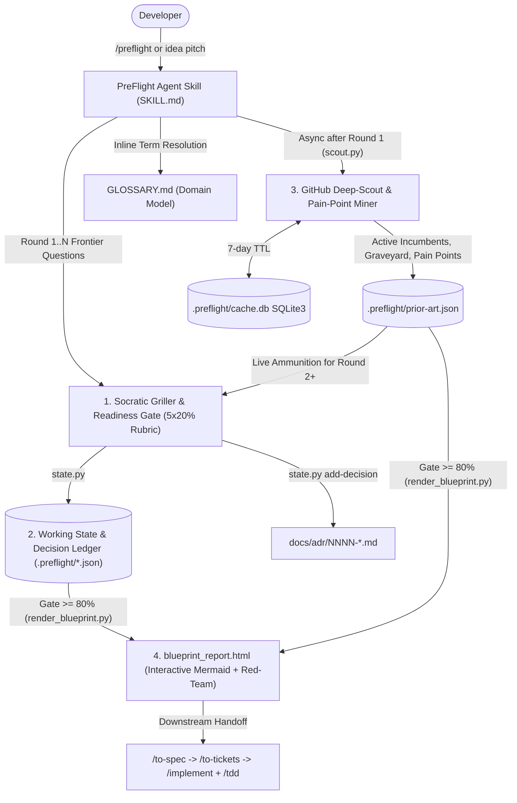

# PreFlight ✈️

**Adversarial Pre-Implementation Architecture Validator, GitHub Prior-Art Scout & System Design Blueprint Generator.**

PreFlight is an agent skill and deterministic toolkit that runs **before** you write code. Instead of acting as a "yes-man" chatbot that blindly praises half-baked ideas, PreFlight interrogates your architecture with Socratic questions, mines GitHub repositories and open issues for real-world user complaints, tracks locked architectural decisions in a 3-tier memory model, and compiles a standalone dark-mode HTML + Mermaid.js **Blueprint** (`blueprint_report.html`).

---

## Why PreFlight Exists

- **The Trap:** Developers jump straight into coding or rely on generic prompt wrappers that validate flawed designs without checking if the idea already failed on GitHub.
- **The Gap:** Existing diagramming and spec tools (like `GitDiagram` or `DeepWiki`) only visualize code *after* a repository is written, or offer superficial idea validation with zero GitHub issue mining.
- **The Solution:** PreFlight forces rigorous architectural thought across 5 dimensions, uncovers hidden competitor flaws from GitHub's highest-voted open issues, and hands off cleanly into spec-driven and test-driven development (`/to-spec`, `/to-tickets`, `/tdd`).

---

## Core Architecture & 4 Pillars



### 1. The Socratic Griller & Readiness Gate (`0%–100%`)
Interrogates your idea in structured rounds (`❓ Q1 ... ➡️ Recommended Answer`) across five dimensions (`20%` each):
1. **Problem & User Pain (`problem`)**: Concrete failure mode of the status quo and target user workflow.
2. **Scope & Non-Goals (`scope`)**: Explicit V1 boundaries and seams.
3. **State & Persistence (`memory`)**: Data model, caching, state lifecycle, and (for AI apps) context/episodic memory.
4. **Bottlenecks & Failure Modes (`bottlenecks`)**: Rate limits, latency, single points of failure, and mitigations.
5. **Prior-Art Differentiation (`differentiation`)**: How the architecture solves real complaints mined from competing GitHub repos.

> **Readiness Gate Rule:** Blueprint generation is **LOCKED** until overall readiness reaches **$\ge 80\%$** with **zero untouched (`0%`) dimensions** (unless explicitly overridden via `--force`).

### 2. Hybrid 3-Tier Stateful Memory
- **Tier 1 — Working State (`.preflight/state.json`)**: Tracks project metadata, tech stack, rubric scores, red-team critiques, and system design diagrams.
- **Tier 2 — Episodic Decision Ledger (`docs/adr/NNNN-*.md` + `.preflight/decisions.json` + `GLOSSARY.md`)**: Append-only log of locked Architecture Decision Records, rejected alternatives, and ubiquitous domain language—git-diffable and readable by downstream coding agents.
- **Tier 3 — GitHub Repo Cache (`.preflight/cache.db`)**: Local SQLite3 database with a 7-day TTL caching repository metadata, star velocity, and mined issue threads to prevent redundant API calls.

### 3. Slow GitHub Deep-Scout & Pain-Point Miner (`scripts/scout.py`)
- Authenticates automatically via `gh auth token` $\to$ `GITHUB_TOKEN` $\to$ unauthenticated fallback.
- **Active Incumbents**: Identifies maintained alternatives pushed within the last 365 days and calculates monthly star velocity.
- **Graveyard Check**: Flags stalled or abandoned repositories ($>365\text{ days}$ inactive or archived) that attempted the same idea.
- **Pain-Point Mining**: Pulls top-voted open issues (`sort:reactions-+1-desc`) across incumbents to expose what real users hate about existing solutions.

### 4. Aesthetic Blueprint Generator (`scripts/render_blueprint.py`)
Renders a self-contained, dark-mode `blueprint_report.html` featuring:
- **Tab 1 — Readiness Scorecard & Adversarial Red-Team Critique**
- **Tab 2 — Prior-Art Matrix (Incumbents vs. Graveyard) & Mined GitHub Pain Points**
- **Tab 3 — Interactive Mermaid.js System Topology & Sequence Diagrams + Trade-Off Matrix**
- **Tab 4 — Decision Ledger (ADRs) & Tracer-Bullet Implementation Plan**

---

## Repository Structure

```text
.
├── AGENTS.md                                  # Workspace agent configuration
├── GLOSSARY.md                                # Ubiquitous domain language for PreFlight
├── blueprint_report.html                      # Self-hosted PreFlight Blueprint example
├── docs/
│   ├── adr/                                   # Architecture Decision Records
│   │   ├── 0001-host-orchestrated-agent-skill.md
│   │   └── 0002-hybrid-repo-native-and-sqlite-state.md
│   └── agents/                                # Issue tracker, triage labels & domain rules
├── skills/
│   └── preflight/
│       ├── SKILL.md                           # Main Agent Skill instructions
│       └── scripts/
│           ├── state.py                       # Working State, Rubric & ADR Ledger CLI
│           ├── scout.py                       # GitHub Deep-Scout & Pain-Point Miner (SQLite)
│           └── render_blueprint.py            # Readiness-Gated HTML + Mermaid renderer
└── tests/
    └── test_preflight.py                      # End-to-end unit & integration test suite
```

---

## Installation

### Install Globally (Antigravity / Gemini / Claude Code / Cursor)

Clone this repository and copy or symlink `skills/preflight` into your agent's skills directory:

```bash
git clone https://github.com/thilak15/preflight.git
cd preflight

# For Antigravity / Gemini CLI (Global)
cp -R skills/preflight ~/.gemini/config/skills/preflight

# Or symlink into any project workspace
mkdir -p /path/to/your-project/.agents/skills
ln -s "$(pwd)/skills/preflight" /path/to/your-project/.agents/skills/preflight
```

### Requirements
- **Python 3.10+** (uses only the Python standard library: `sqlite3`, `urllib`, `json`, `argparse` — zero `pip install` dependencies required!)
- Optional: [GitHub CLI (`gh`)](https://cli.github.com/) authenticated (`gh auth login`) or `GITHUB_TOKEN` env var for higher GitHub Search API rate limits ($5,000\text{ req/hr}$ vs. $60\text{ req/hr}$).

---

## Usage

### 1. Inside Your AI Coding Agent (Recommended)
Trigger the skill directly in chat before starting a project:

```text
/preflight I want to build <your project idea>
```

The agent will:
1. Initialize `.preflight/state.json` and `GLOSSARY.md`.
2. Grill you with Round 1 frontier questions (`❓ Q1 ... ➡️ Recommended Answer`).
3. Run `scout.py` in the background to mine GitHub incumbents, graveyard repos, and top-voted open issues.
4. Challenge your design in Round 2+ using the mined GitHub pain points and record ADRs in `docs/adr/`.
5. Unlock the Readiness Gate ($\ge 80\%$) and render `blueprint_report.html`.

### 2. Direct CLI Usage (Helper Scripts)

You can also invoke the deterministic helper scripts directly:

```bash
# 1. Initialize project state
python3 skills/preflight/scripts/state.py --workspace . init \
  --name "MyProject" \
  --summary "Distributed job scheduler in Rust" \
  --runtime "Rust 1.80 / Tokio" \
  --stack "Rust,SQLite,gRPC"

# 2. Run the GitHub Deep-Scout & Pain-Point Miner
python3 skills/preflight/scripts/scout.py --workspace . \
  -q "distributed job scheduler rust" \
  -q "lightweight workflow engine"

# 3. Update a dimension score (0, 10, or 20)
python3 skills/preflight/scripts/state.py --workspace . update-dimension \
  --dimension problem --score 20 \
  --summary "Replaces heavy Airflow deployments for single-node edge clusters" \
  --edge-case "Clock skew across edge nodes"

# 4. Record an Architecture Decision Record (writes docs/adr/NNNN-*.md)
python3 skills/preflight/scripts/state.py --workspace . add-decision \
  --title "Embedded SQLite WAL over Postgres" \
  --decision "Use SQLite in WAL mode for single-binary zero-ops deployment" \
  --rejected "External PostgreSQL cluster" \
  --rationale "Target users deploy on single edge nodes" \
  --dimension memory

# 5. Render the standalone HTML Blueprint (requires >=80% readiness or --force)
python3 skills/preflight/scripts/render_blueprint.py --workspace . --output blueprint_report.html
```

---

## Running Tests

```bash
python3 -m unittest discover -s tests -v
```

---

## License

MIT
