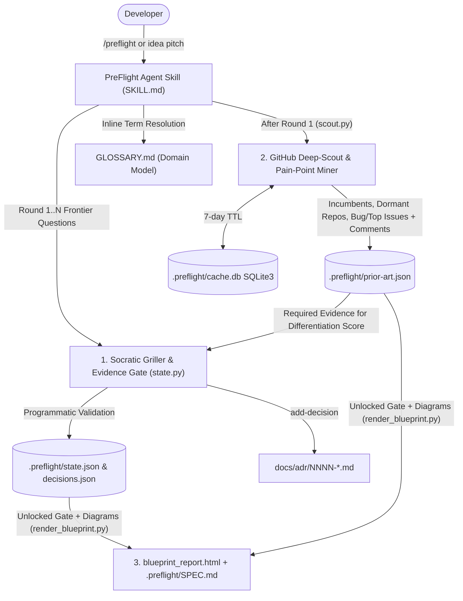

# PreFlight ✈️

[](https://github.com/thilak15/preflight/actions/workflows/ci.yml)
[](./LICENSE)

**Pre-Implementation Architecture Validator, GitHub Prior-Art Scout & System Design Specification Generator.**

PreFlight is a self-contained Agent Skill (`SKILL.md`) paired with three deterministic, zero-dependency Python helper scripts (`state.py`, `scout.py`, `render_blueprint.py`) that run **before** you write code. Instead of acting as a "yes-man" assistant that praises half-baked ideas, PreFlight interrogates your architecture in structured Socratic rounds, queries the GitHub Search and Issues APIs to uncover competing repositories and real user pain points, enforces programmatic evidence gates on architectural decisions, and compiles both an interactive dark-mode `blueprint_report.html` and a clean `.preflight/SPEC.md` specification.

---

## See a Real PreFlight Pivot (`examples/edge-cron-scheduler/`)

Want to see how PreFlight actually changes a flawed system design before code is written? Check out the complete before/after case study in [`examples/edge-cron-scheduler/`](./examples/edge-cron-scheduler/):

- **[`CASE_STUDY.md`](./examples/edge-cron-scheduler/CASE_STUDY.md)**: Full Socratic transcript showing how a developer's initial pitch (*"distributed edge cron over embedded etcd Raft"*) was challenged by network-partition edge cases and live GitHub prior art (`dagu-org/dagu#412` orphan subprocess leaks, archived `SimpleHQ/simple-etcd-cron`) and pivoted into an autonomous SQLite WAL + Linux `cgroups v2` step-isolated design.
- **[`SPEC.md`](./examples/edge-cron-scheduler/SPEC.md)**: The auto-exported Markdown specification produced by `render_blueprint.py`.
- **[`blueprint_report.html`](./examples/edge-cron-scheduler/blueprint_report.html)**: The generated 4-tab HTML Blueprint with Mermaid topology/sequence diagrams and offline source fallbacks.

---

## Architecture & How It Works



### 1. Evidence-Gated 5-Dimension Rubric (`scripts/state.py`)
PreFlight evaluates projects across five dimensions (`20%` each, `0%–100%` total):
1. **Problem & User Pain (`problem`)**: Concrete failure mode of the status quo and target user workflow.
2. **Scope & Non-Goals (`scope`)**: Explicit V1 boundaries and seams.
3. **State & Persistence (`memory`)**: Data model, caching, state lifecycle, and (for AI apps) context/session state.
4. **Bottlenecks & Failure Modes (`bottlenecks`)**: Rate limits, latency, single points of failure, and mitigations.
5. **Prior-Art Differentiation (`differentiation`)**: How the architecture solves real complaints mined from competing GitHub repos.

**Programmatic Anti-Theater Enforcement:**
Unlike prompt-only skills where an LLM can award itself `100%` with one-line summaries, `state.py` enforces strict programmatic rules:
- Scoring `20/20` on any dimension **fails** unless the summary is substantive ($\ge 40$ chars) and includes at least **2 concrete stress-tested edge cases** (`--edge-case`).
- Scoring `differentiation > 0` **fails** unless `.preflight/prior-art.json` exists from a real `scout.py` run, and scoring `20/20` **fails** unless the summary or edge cases explicitly cite at least one discovered repository (`owner/repo`) from `prior-art.json`.
- Unlocking the **Readiness Gate** additionally requires $\ge 80\%$ total score, zero `0%` dimensions, $\ge 1$ recorded Architecture Decision Record (`add-decision`), and $\ge 1$ recorded Red-Team Critique (`add-critique`).

### 2. GitHub Deep-Scout & Pain-Point Miner (`scripts/scout.py`)
- **Authentication & Rate-Limit Inspection**: Authenticates via `gh auth token` $\to$ `GITHUB_TOKEN` $\to$ unauthenticated fallback, and inspects `X-RateLimit-Remaining`, `X-RateLimit-Limit`, and `Retry-After` headers for GitHub's Search API (**30 requests/minute** authenticated, **10 requests/minute** unauthenticated).
- **SQLite Caching (`.preflight/cache.db`)**: Caches all repository, issue, and comment payloads locally with a 7-day TTL.
- **Documented Repository Filtering**: Scopes free-text queries to `in:name,description` by default (preventing full-README keyword-stuffing false positives) while preserving Markdown-only repositories (`language: None`) so documentation and agent skill repos are never dropped.
- **Two-Pass Issue & Top-Comment Mining**:
  - **Pass A (`top_voted`)**: Top open issues sorted by `reactions-+1-desc`.
  - **Pass B (`bug_or_failure`)**: Open `label:bug` issues sorted by `reactions-+1-desc` to surface real engineering failures rather than feature-tracker threads.
  - **Engagement Threshold**: Excludes 0-vote, low-comment noise (`reactions_plus_one >= 1` or `comments >= 2` required).
  - **Top Comments (`top_comments`)**: Fetches the highest-voted comments on top issues so you see actual developer root-cause analyses and workarounds.

### 3. Blueprint & Specification Renderer (`scripts/render_blueprint.py`)
- Refuses to ship placeholder diagrams behind a passed gate: `topology_mermaid` and `sequence_mermaid` must be populated via `state.py set-design`.
- Generates **two synchronized outputs**:
  1. `blueprint_report.html`: Dark-mode 4-tab dashboard with Mermaid.js diagrams, collapsible `<details>` raw Mermaid source blocks (for offline viewing), and a 1-click **"Copy Spec Markdown"** button.
  2. `.preflight/SPEC.md`: Clean, git-ready Markdown specification containing the executive summary, stress-tested edge cases, red-team critiques, prior-art matrix, Mermaid diagrams, and ADR ledger.

---

## Installation

### Option A: One-Command Install (`skills.sh` / Claude Code / Cursor / Codex)

```bash
npx skills@latest add thilak15/preflight
```

### Option B: Clone & Install Globally (Antigravity / Gemini CLI / Claude Code)

```bash
git clone https://github.com/thilak15/preflight.git
cd preflight

# Install globally for Antigravity / Gemini
cp -R skills/preflight ~/.gemini/config/skills/preflight
```

### Requirements
- **Python 3.10+** (100% Python standard library — zero `pip install` packages required).
- Optional: [GitHub CLI (`gh`)](https://cli.github.com/) authenticated (`gh auth login`) or `GITHUB_TOKEN` env var for the authenticated GitHub Search API quota (`30 req/min` vs. `10 req/min` unauthenticated).

---

## Usage

### 1. Inside Your AI Coding Agent
Invoke `/preflight` in any workspace before writing code:

```text
/preflight I want to build <your project idea>
```

### 2. Direct CLI Usage

```bash
# 1. Initialize project state
python3 skills/preflight/scripts/state.py --workspace . init \
  --name "EdgeCron" \
  --summary "Autonomous Linux edge DAG scheduler with cgroup v2 step isolation" \
  --runtime "Go 1.23 (Linux)" \
  --stack "Go,SQLite3 WAL,Linux cgroups v2"

# 2. Run the GitHub Deep-Scout & Pain-Point Miner
python3 skills/preflight/scripts/scout.py --workspace . \
  -q "dag scheduler single binary" \
  -q "cron alternative web ui go"

# 3. Update a dimension score (enforces >=40 char summary & >=2 edge cases for 20/20)
python3 skills/preflight/scripts/state.py --workspace . update-dimension \
  --dimension differentiation --score 20 \
  --summary "Unlike dagu-org/dagu (#412 orphan subprocess leaks), EdgeCron isolates every step in a Linux cgroup v2 scope." \
  --edge-case "Solves dagu-org/dagu#412 by writing 1 to cgroup.kill on step timeout" \
  --edge-case "Autonomous per-node SQLite WAL avoids etcd quorum loss during WAN cuts"

# 4. Record ADRs and Red-Team Critiques
python3 skills/preflight/scripts/state.py --workspace . add-decision \
  --title "Linux cgroups v2 Per-Step Isolation" \
  --decision "Spawn each DAG step inside a dedicated cgroup v2 scope with memory.max and cgroup.kill teardown." \
  --rejected "Standard Go os/exec Process.Kill()" \
  --rationale "Guarantees zero orphaned grandchild processes (dagu-org/dagu#412)." \
  --dimension bottlenecks

python3 skills/preflight/scripts/state.py --workspace . add-critique \
  --title "Post-Outage Cron Stampede on Reboot" \
  --severity high \
  --attack "After a 4-hour power outage, firing 240 missed 1-minute jobs simultaneously exhausts 1GB edge RAM." \
  --mitigation "Enforce per-DAG catchup_policy (skip | latest_only | backfill_serial)."

# 5. Set Mermaid diagrams, trade-offs, and implementation plan
python3 skills/preflight/scripts/state.py --workspace . set-design \
  --topology "flowchart LR\n    CLI --> Daemon --> SQLite[(SQLite WAL)]" \
  --sequence "sequenceDiagram\n    CLI->>Daemon: Trigger DAG\n    Daemon->>SQLite: Commit state" \
  --option "SQLite WAL + cgroups v2|100% offline availability, zero orphans|Linux-only|Selected (ADR-0001)" \
  --step "Implement SQLite WAL state machine and single-writer batch loop" \
  --step "Implement Linux cgroup v2 scope runner with cgroup.kill teardown"

# 6. Render blueprint_report.html and .preflight/SPEC.md
python3 skills/preflight/scripts/render_blueprint.py --workspace . \
  --output blueprint_report.html \
  --spec-output .preflight/SPEC.md
```

---

## Repository Structure

```text
.
├── .claude-plugin/
│   └── plugin.json                            # Plugin manifest for 1-command skill installers
├── .github/workflows/
│   └── ci.yml                                 # GitHub Actions CI across Python 3.10, 3.11, 3.12
├── AGENTS.md                                  # Repository engineering rules
├── GLOSSARY.md                                # Ubiquitous domain language for PreFlight
├── LICENSE                                    # MIT License
├── README.md                                  # Documentation
├── docs/adr/                                  # Architecture Decision Records
│   ├── 0001-host-orchestrated-agent-skill.md
│   └── 0002-hybrid-repo-native-and-sqlite-state.md
├── examples/edge-cron-scheduler/              # End-to-end before/after case study & artifacts
│   ├── CASE_STUDY.md
│   ├── SPEC.md
│   └── blueprint_report.html
├── skills/preflight/
│   ├── SKILL.md                               # Main Agent Skill instructions
│   └── scripts/
│       ├── state.py                           # Evidence-Gated Working State & ADR Ledger CLI
│       ├── scout.py                           # GitHub Deep-Scout & Issue/Comment Miner
│       └── render_blueprint.py                # HTML Blueprint & SPEC.md renderer
└── tests/
    └── test_preflight.py                      # Automated unit & integration test suite
```

---

## Running Tests

```bash
python3 -m unittest discover -s tests -v
```

---

## License

Released under the [MIT License](./LICENSE).
