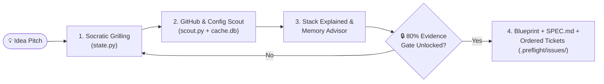

<div align="center">

# ✈️ PreFlight

**Validate your architecture, scout GitHub prior art, lock your stack, and generate ready-to-code tickets — before writing a single line of code.**

[](https://github.com/thilak15/preflight/actions/workflows/ci.yml)
[](https://www.python.org/)
[-10b981)](#install)
[](./LICENSE)

[**What It Does**](#-what-preflight-does) · [**Quick Start**](#-quick-start) · [**5-Dimension Gate**](#-the-5-dimension-readiness-gate) · [**Generated Artifacts**](#-what-gets-generated) · [**Case Study**](./examples/edge-cron-scheduler/CASE_STUDY.md) · [**CLI Reference**](#-cli-reference)

</div>

---

## Why PreFlight?

Most AI coding assistants act like eager "yes-men": pitch an idea and they immediately scaffold code on shaky assumptions, pick a Vector DB when SQLite FTS5 would do, or reinvent a library that already has 10k stars on GitHub.

**PreFlight** runs *before* implementation. It combines a structured Socratic interview with a live GitHub prior-art & config-file scout to stress-test your design, lock architectural decisions, and output a complete blueprint and ordered issue queue.

---

## ✨ What PreFlight Does

| Stage | Capability | How It Works |
| :--- | :--- | :--- |
| **1. Interrogate** | **Socratic Frontier Grilling** | Challenges your idea across 5 dimensions (`Problem`, `Scope`, `Memory`, `Bottlenecks`, `Differentiation`) with concrete `➡️` recommended answers. |
| **2. Scout** | **GitHub Prior-Art & Pain-Point Miner** | Finds **Active Incumbents**, **Graveyard Repos** ($>365\text{d}$ dormant), **OSS Building Blocks**, and top-voted open issues + developer comments. |
| **3. Inspect** | **"Stack Explained" (`Now` vs. `Later`)** | Inspects real repo config files (`pyproject.toml`, `Dockerfile`, `.github/workflows`, `.pre-commit-config.yaml`) and records every tool's job, why it's needed now, the alternative, and **`NOW`** vs. **`LATER`**. |
| **4. Advise** | **Memory & Agent Communication** | Prescribes the right state strategy (`stateless`, `transactional-db`, `lexical-fts`, `rag-vector-db`, `hybrid-search`, `episodic-agent-state`), handoff schema, and memory failure modes. |
| **5. Compile** | **Blueprint, Spec & Ordered Tickets** | Enforces an **80% Evidence Gate**, then compiles `blueprint_report.html`, `.preflight/SPEC.md`, `.preflight/STACK.md`, and dependency-ordered tickets in `.preflight/issues/01-*.md`. |

---

## 🚀 Quick Start

### 1. Install

**Via `skills.sh` (Claude Code / Cursor / Codex / Antigravity):**
```bash
npx skills@latest add thilak15/preflight
```

**Or clone directly (Zero dependencies — Python 3.10+ standard library only):**
```bash
git clone https://github.com/thilak15/preflight.git
cd preflight
cp -R skills/preflight ~/.gemini/config/skills/preflight
```

> **Tip:** Authenticate [GitHub CLI](https://cli.github.com/) (`gh auth login`) or set `GITHUB_TOKEN` for the full `30 req/min` GitHub Search API quota (falls back to `10 req/min` unauthenticated).

### 2. Run Inside Your Agent

```text
/preflight I want to build <your project idea>
```

Want to run a **brand-new idea** in the same folder or **re-run from a clean slate**?
```bash
python3 skills/preflight/scripts/state.py --workspace . reset
```

---

## 🧭 Workflow Overview



---

## 🛡️ The 5-Dimension Readiness Gate

Unlike prompt-only skills where an LLM can grade itself `100%` with one-line summaries, `state.py` enforces **programmatic anti-theater checks** before unlocking Blueprint generation:

| Dimension | Weight | Required to Score `20/20` (Programmatically Enforced) |
| :--- | :---: | :--- |
| **1. Problem & User Pain** (`problem`) | `20%` | Substantive summary ($\ge 40$ chars) + $\ge 2$ stress-tested `--edge-case` scenarios |
| **2. Scope & Non-Goals** (`scope`) | `20%` | Explicit V1 non-goals + $\ge 2$ hard boundary `--edge-case` items |
| **3. State, Memory & Agent Comm** (`memory`) | `20%` | Memory strategy (`stateless` / `SQLite` / `FTS5` / `RAG` / `Hybrid`), agent handoff pattern, and $\ge 2$ failure modes |
| **4. Bottlenecks & Failure Modes** (`bottlenecks`) | `20%` | Rate limits, latency, SPOFs, and $\ge 2$ stress-tested mitigations |
| **5. Prior-Art Differentiation** (`differentiation`) | `20%` | Requires `.preflight/prior-art.json` from `scout.py` and must explicitly cite $\ge 1$ discovered `owner/repo` |

**Gate Unlock Rule:** Total score $\ge 80\%$, zero dimensions at `0%`, $\ge 1$ ADR (`add-decision`), $\ge 1$ Red-Team Critique (`add-critique`), and both Mermaid diagrams (`topology` + `sequence`) populated.

---

## 📦 What Gets Generated

When the Readiness Gate unlocks and `render_blueprint.py` runs, PreFlight produces a complete engineering package:

| Artifact | Purpose |
| :--- | :--- |
| **`blueprint_report.html`** | Interactive 5-tab dark-mode HTML dashboard (Scorecard, Prior-Art & Pain Points, Stack Explained & Memory, Mermaid Diagrams, ADR Ledger). |
| **`.preflight/SPEC.md`** | Clean, git-ready system design specification. |
| **`.preflight/STACK.md`** | **"Stack Explained"** table (`Now` vs. `Later`, config-file proof, alternatives) + Memory & Agent Communication architecture. |
| **`.preflight/issues/01-*.md`** | Individual, dependency-ordered vertical-slice tickets (`01`, `02`, `03`...) ready to build sequentially one-by-one. |
| **`docs/adr/NNNN-*.md`** | Permanent Architecture Decision Records with rejected alternatives. |
| **`GLOSSARY.md`** | Ubiquitous domain language maintained throughout the interview. |

---

## 📖 Real Case Study (`examples/edge-cron-scheduler/`)

See how PreFlight turned a fragile *"distributed edge cron over embedded etcd"* pitch into an autonomous **SQLite WAL + Linux `cgroups v2`** architecture after mining real issues like `dagu-org/dagu#412`:

- 📄 **[Read the Case Study Transcript](./examples/edge-cron-scheduler/CASE_STUDY.md)**
- 📋 **[View the Exported `SPEC.md`](./examples/edge-cron-scheduler/SPEC.md)** & **[`STACK.md`](./examples/edge-cron-scheduler/STACK.md)**
- 🎟️ **[Browse the Generated Ordered Tickets (`issues/INDEX.md`)](./examples/edge-cron-scheduler/issues/INDEX.md)**
- 🖥️ **[Open `blueprint_report.html`](./examples/edge-cron-scheduler/blueprint_report.html)**

---

## 🛠️ CLI Reference

<details>
<summary><strong>Click to expand full CLI commands (<code>state.py</code>, <code>scout.py</code>, <code>render_blueprint.py</code>)</strong></summary>

<br/>

```bash
# 1. Initialize (or pass --reset to wipe any previous run cleanly)
python3 skills/preflight/scripts/state.py --workspace . init --reset \
  --name "EdgeCron" \
  --summary "Autonomous Linux edge DAG scheduler with cgroup v2 step isolation" \
  --runtime "Go 1.23 (Linux)" \
  --stack "Go,SQLite3 WAL,Linux cgroups v2"

# 2. Scout GitHub Competitors (-q), OSS Building Blocks (-t), and Repo Config Files
python3 skills/preflight/scripts/scout.py --workspace . \
  -q "dag scheduler single binary" \
  -t "golang sqlite wal library"

# 3. Add "Stack Explained" entries (What job it does, why needed, alternative, NOW vs LATER, config proof)
python3 skills/preflight/scripts/state.py --workspace . add-tool \
  --category container-runtime \
  --recommended "Docker (Multi-stage build)" \
  --stage now \
  --config-proof "Dockerfile" \
  --purpose "Reproducible static binary build & local integration test harness" \
  --why "Guarantees identical Linux kernel headers and SQLite build flags across dev and CI" \
  --alternatives "Host-native go build (drifts across macOS/Linux developer machines)"

# 4. Configure Memory & Agent/Component Communication Architecture
python3 skills/preflight/scripts/state.py --workspace . set-memory-arch \
  --strategy transactional-db \
  --communication "Single-writer Go channel batching step heartbeats into SQLite WAL" \
  --workflow " Append-only run state transitions flushed every 100ms" \
  --rationale "Deterministic state recovery on power loss without external DB or Vector overhead" \
  --alternatives "etcd Raft (loses quorum on 2-node WAN splits); Redis (volatile on power loss)" \
  --failure-mode "SQLITE_BUSY under 50+ concurrent step heartbeats -> Mitigated by single writer goroutine"

# 5. Score Dimensions, Record ADRs & Red-Team Critiques
python3 skills/preflight/scripts/state.py --workspace . update-dimension \
  --dimension differentiation --score 20 \
  --summary "Unlike dagu-org/dagu (#412 orphan subprocess leaks), EdgeCron isolates every step in a Linux cgroup v2 scope." \
  --edge-case "Solves dagu-org/dagu#412 by writing 1 to cgroup.kill on step timeout" \
  --edge-case "Autonomous per-node SQLite WAL avoids etcd quorum loss during WAN cuts"

python3 skills/preflight/scripts/state.py --workspace . add-decision \
  --title "Linux cgroups v2 Per-Step Isolation" \
  --decision "Spawn each DAG step inside a dedicated cgroup v2 scope with cgroup.kill teardown." \
  --rejected "Standard Go os/exec Process.Kill()" \
  --rationale "Prevents orphaned grandchild processes (dagu-org/dagu#412)." \
  --dimension bottlenecks

python3 skills/preflight/scripts/state.py --workspace . add-critique \
  --title "Post-Outage Cron Stampede on Reboot" \
  --severity high \
  --attack "Firing 240 missed 1-minute jobs simultaneously after a 4-hour outage exhausts 1GB RAM." \
  --mitigation "Enforce per-DAG catchup_policy (skip | latest_only | backfill_serial)."

# 6. Set Diagrams & Render Blueprint + SPEC.md + STACK.md + Ordered Tickets (.preflight/issues/)
python3 skills/preflight/scripts/state.py --workspace . set-design \
  --topology "flowchart LR\n    CLI --> Daemon --> SQLite[(SQLite WAL)]" \
  --sequence "sequenceDiagram\n    CLI->>Daemon: Trigger DAG\n    Daemon->>SQLite: Commit state" \
  --option "SQLite WAL + cgroups v2|100% offline availability, zero orphans|Linux-only|Selected (ADR-0001)" \
  --step "Implement SQLite WAL state machine and single-writer batch loop" \
  --step "Implement Linux cgroup v2 scope runner with cgroup.kill teardown"

python3 skills/preflight/scripts/render_blueprint.py --workspace .
```

</details>

---

## 📂 Repository Layout

```text
preflight/
├── skills/preflight/
│   ├── SKILL.md                     # Self-contained Agent Skill instructions
│   └── scripts/
│       ├── state.py                 # Readiness Gate, Stack Explained, Memory Advisor & Ticket Exporter
│       ├── scout.py                 # GitHub Deep-Scout, Config Inspector & Issue/Comment Miner
│       └── render_blueprint.py      # 5-tab HTML Blueprint, SPEC.md, STACK.md & Ticket compiler
├── examples/edge-cron-scheduler/    # Complete before/after architectural pivot case study
├── docs/adr/                        # Architecture Decision Records (0001–0003)
├── tests/test_preflight.py          # Zero-dependency unit & integration test suite
└── GLOSSARY.md                      # Domain vocabulary
```

## 🧪 Testing

```bash
python3 -m unittest discover -s tests -v
```

## 📄 License

Released under the [MIT License](./LICENSE).
